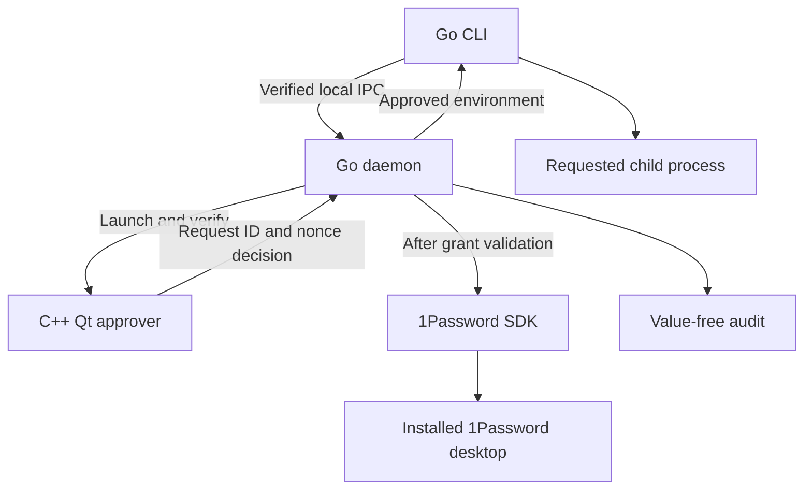
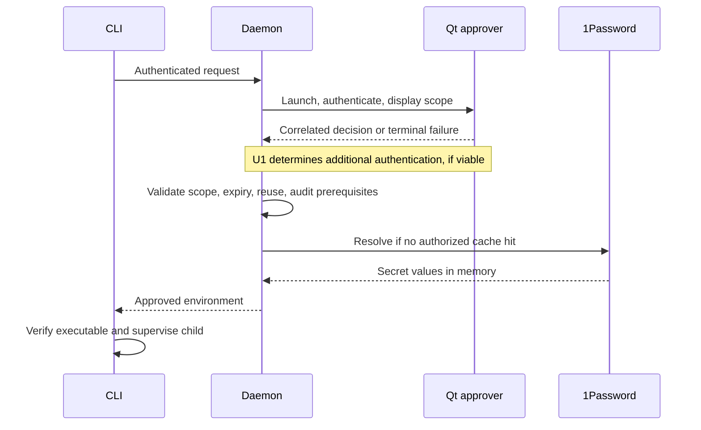
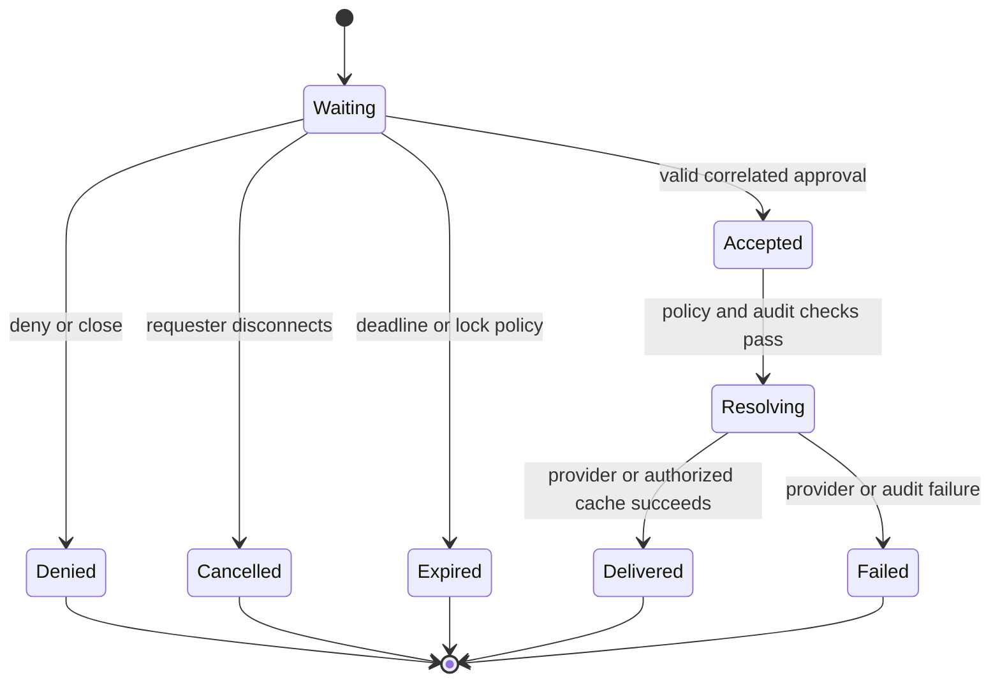

<!-- markdownlint-configure-file {"MD025": {"front_matter_title": ""}} -->

# Omarchy Linux Support - Plan

## Goal Capsule

- **Objective:** Omarchy users on ARM64 and x86-64 can review and approve
  short-lived 1Password access for commands through Agent Secret.
- **Means:** Retain the Go CLI/broker and add a C++/Qt Linux approver, native
  packages, and desktop validation on both architectures (KTD1, KTD2, KTD8).
- **Authority:** Product requirements below govern behavior; technical decisions
  govern implementation within those requirements. `AGENTS.md` and
  `docs/threat-model.md` remain project constraints, with an explicit Linux
  threat-model amendment delivered through U1.
- **Execution:** This document plans implementation; it does not authorize
  implementation, commits, branch changes, publication, or releases. Future
  implementation should add focused tests before behavior changes and keep live
  provider tests opt-in.
- **Completion ownership:** The implementer supplies tested packages and
  evidence. The operator performs provider sign-in/authentication and makes the
  release decision.

---

## Product Contract

### Summary

Deliver Omarchy support on ARM64 and x86-64 with 1Password desktop integration
and native approval prompts. Use the provided ARM VM throughout development and
validate an x86-64 desktop before claiming support for that architecture.
Investigate resistance to automated approval using 1Password's Linux design as
evidence, with a bounded scope that allows porting work to continue.

### Problem Frame

The Go broker already owns request validation, scoped grants, sessions, provider
access, and audit records, but its platform boundaries assume macOS. Omarchy
users currently lack working process verification, native approval presentation,
and an installable Linux product. The immediate test machine is ARM64; x86-64
remains a required release target, and ARM VM success alone cannot establish
compatibility with future bare-metal Apple Silicon installations.

### Key Decisions

- **1Password first.** Governs R2. (session-settled: user-directed — chosen over
  first-release Bitwarden parity: Linux credential storage can follow
  separately.)
- **Both architectures in the first release.** Governs R1, R9. (session-settled:
  user-directed — chosen over x86-only scope: the development VM and expected
  Apple Silicon use require ARM64 support.)
- **Investigate approval resistance without making it an indefinite blocker.**
  Governs R7. (session-settled: user-directed — chosen over requiring a fully
  proven anti-automation mechanism before porting: study 1Password and keep the
  port moving.)

### Requirements

#### Platform and provider

- R1. Support native Linux `aarch64`/Go `arm64` and `x86_64`/Go `amd64` builds
  on Omarchy with Hyprland/Wayland.
- R2. Resolve approved references through 1Password desktop integration; report
  Bitwarden as unsupported on Linux without changing its macOS behavior.
- R3. Preserve the existing CLI capabilities for 1Password: exec, profiles, env
  files, item metadata, bounded sessions, reusable approvals, and daemon
  diagnostics.

#### Approval and trust

- R4. Display the complete approval scope and preserve the current denial,
  cancellation, expiry, reuse, and session-binding rules.
- R5. Authenticate CLI, daemon, and approver peers using Linux process identity;
  reject fake peers and replaced installed executables.
- R6. Preserve value-free audit and diagnostics, memory-only secret handling,
  and CLI ownership of child execution.
- R7. Evaluate agent-driven approval against 1Password's documented Linux
  mechanisms and measured desktop behavior. Record enforceable protections and
  residual desktop-control limits explicitly; universal resistance to a
  compromised desktop is not a prerequisite for completing the port.

#### Distribution and verification

- R8. Install, upgrade, diagnose, and uninstall through a documented package
  workflow that preserves unrelated files and existing user audit data.
- R9. Validate the installed product on native ARM64 and x86-64 Linux desktops;
  label VM evidence and real-device evidence separately.
- R10. Keep macOS behavior and release validation intact while adding Linux
  build, test, and package jobs.

### Scope Assumptions for Review

The following are proposed defaults, not confirmed product decisions:

- Deliver a publicly installable Omarchy preview, rather than stopping at a
  personal VM build or promising support for every distribution.
- Match the current one-shot approval and setup/diagnostic surfaces. A
  persistent tray app and grant-management window are follow-up product work.

### Scope Boundaries

The initial compatibility claim covers the recorded Omarchy desktop baselines
and both CPU architectures. Generic distribution installers, X11 support, a
macOS Qt rewrite, and remote approval across machines are outside this release.

Deferred follow-up work includes Bitwarden's Linux credential store, broader
distributions, and bare-metal Apple Silicon graphics/input validation when a
suitable machine is available. ARM64 packaging belongs in this release under R1;
hardware-specific validation does not justify delaying ARM64 builds.

### Acceptance Examples

- AE1. A command requested from an Omarchy terminal shows the exact scope.
  Approval delivers the synthetic test value only to the child; denial starts no
  child and performs no new secret resolution. Covers R2–R6.
- AE2. A reused grant avoids a new prompt only inside its existing scope,
  expiry, use count, and process-tree binding. A sibling process cannot replay
  the bounded session. Covers R3–R5.
- AE3. A desktop locked before presentation, expired request, closed prompt, or
  disconnected requester produces the corresponding terminal failure rather than
  a late approval. Covers R4.
- AE4. An upgraded package detects an incompatible running daemon and gives a
  safe restart path without silently preserving old grants. Covers R8.
- AE5. The same package-level smoke scenarios succeed on ARM64 and x86-64, with
  the target's own 1Password application and IPC library. Covers R1, R9.

---

## Planning Contract

### Verified Baseline

Repository HEAD and remote `main` were both
`80ce745c96d3d1e3ec17f28b37aa6882d33b9f77` on 2026-09-23. The checkout was clean
before this plan. No Linux product build, provider authentication, or GUI
interaction was performed during this planning pass.

<!-- markdownlint-disable MD013 -->

| Area               | Observed state                                                                                                  | Planning consequence                                                                     |
| ------------------ | --------------------------------------------------------------------------------------------------------------- | ---------------------------------------------------------------------------------------- |
| ARM test guest     | Arch Linux ARM, QEMU, `try-omarchy-runtime 4.0.3-1`, upstream commit `0534987009061cbe2dacdde4ad564092ab698d12` | Record this baseline; an older version file still says `4.0.0.alpha`                     |
| Desktop            | Hyprland `0.56.1-3.2`, Wayland, 3024×1702 at 2× scale                                                           | Include HiDPI, tiling/floating, focus, and lock behavior                                 |
| Qt                 | Qt `6.11.2`; base, declarative, and Wayland packages installed; platform theme `gtk3`                           | Qt fits the existing desktop; GTK is also supported                                      |
| 1Password          | Native ARM64 desktop installed outside pacman; wrapper selects software rendering; app not running              | Installation exists, but sign-in, SDK integration, and live resolution remain unverified |
| Build tools        | GCC/G++ and Make available; Go, CMake, Ninja, and pkg-config absent                                             | Provision reproducible development dependencies in U1/U2                                 |
| Inspection         | SSH works; `grim`, `hyprctl`, and ImageMagick available; no VNC/RDP service found                               | SSH plus targeted screenshots is the first validation path                               |
| Privileges         | Passwordless sudo succeeds in this test guest                                                                   | Suitable for deployment; not evidence of security against an agent able to become root   |
| Existing toolchain | Go 1.26, macOS Swift approver, platform-specific setup/build/test scripts                                       | Split platform toolchains without making Linux install Swift tooling                     |

<!-- markdownlint-enable MD013 -->

Private SSH endpoints, VM credentials, and test-item references belong in
execution configuration, not product defaults or committed fixtures.

### Key Technical Decisions

- KTD1. **Keep the existing process ownership.** The Go daemon owns policy,
  providers, grants, cache, and audit; the CLI owns child processes; the GUI
  receives metadata only. Extend the platform boundaries identified in
  `docs/code-layout.md` instead of introducing another broker or protocol.
- KTD2. **Use C++ with Qt 6 Widgets and CMake.** This is a small, text-heavy
  approval form with existing keyboard and disclosure behavior. Widgets offers
  mature text/layout controls and software rendering; Qt Quick remains viable
  but adds a QML/style/rendering surface with no demonstrated need here. Use
  system Qt libraries, an explicit supported compiler standard, Qt Test,
  formatting, and static-analysis checks. Keep Linux sources under a new
  `approver-linux/` sibling of the Swift package.
  [Qt UI comparison](https://doc.qt.io/qt-6/topics-ui.html)
- KTD3. **Keep platform code in existing owners.** Add Linux implementations for
  peer credentials, process metadata, executable identity, paths, launch, and
  supervision. Preserve existing interfaces where they express the needed
  invariant; add narrowly scoped platform data where Linux requires it. Avoid a
  general plugin architecture.
- KTD4. **Treat executable trust and process hardening as one design.** Use
  kernel-supplied peer credentials, stable process birth identity, and validated
  installed executable identity. Root-owned, non-writable installation paths
  establish a filesystem trust anchor but do not alone prove untampered process
  execution. Verify loader/environment behavior, Qt plugin loading, PID reuse,
  and `/proc` accessibility before finalizing the arrangement. In particular,
  `PR_SET_DUMPABLE=0` can prevent the same-UID executable inspection that mutual
  trust requires; do not add it as an isolated checkbox.
- KTD5. **Keep the Linux approver protocol compatible.** Reuse
  `testdata/approval_protocol/` and the existing frame limits, request IDs,
  nonces, request kinds, and terminal decisions. The Qt client verifies its
  daemon before rendering metadata. Close, cancel, expiry, and transport failure
  cannot produce approval.
- KTD6. **Bound the approval-security spike to two implementation days.**
  Compare 1Password CLI polkit/PAM and SDK process authorization, then measure a
  synthetic Qt prompt and one non-cached polkit candidate. Keep per-request
  binding and grant policy in the daemon. A missing practical anti-automation
  mechanism produces a documented preview limitation and follow-up, not an
  open-ended authentication redesign. Concrete violations of the declared
  broker/peer boundary still require correction. Implements R7.
- KTD7. **Use explicit 1Password account configuration first.** Prefer the
  existing config/flag path and actionable diagnostics over scraping private
  desktop databases. Audit the pinned SDK fork and installed IPC library on each
  target; upstream documentation is not proof that this fork works unchanged.
  Evaluate fork removal only under `docs/dependency-notes.md` criteria.
- KTD8. **Package through Arch tooling for each architecture.** Build native
  packages with root-owned installed binaries and explicit Qt/Wayland runtime
  dependencies. Install the CLI at `/usr/bin/agent-secret`, helpers under
  `/usr/lib/agent-secret/`, and the bundled skill under
  `/usr/share/agent-secret/skills/agent-secret/`. Adapt existing sibling-binary
  and relative-skill discovery to that layout. Keep source packaging
  reproducible with a `PKGBUILD`; sign binary release packages and document
  trust-key bootstrap. Start with release downloads and package-manager
  installation, leaving an AUR publication or hosted pacman repository optional.
  A writable unpacked binary directory is a development mode, not the production
  trust anchor.
- KTD9. **Retain on-demand daemon startup initially.** Use the logged-in user's
  graphical session and Linux runtime/state paths. A request from SSH may target
  that same active desktop through a validated environment; missing or ambiguous
  graphical context fails with guidance. Do not introduce a persistent service
  solely to support testing. If a service becomes necessary for the proven
  identity arrangement in KTD4, resolve that before U3 and document the
  lifecycle change.

### What 1Password Establishes

The
[Linux CLI integration](https://www.1password.dev/cli/app-integration-security)
uses polkit/PAM and a setgid CLI identity. The
[SDK integration](https://www.1password.dev/sdks/desktop-app-integrations)
instead identifies the caller through OS process metadata and grants
per-process/account access, with inactivity expiry and revocation on lock. These
are separate authorization models.

Neither upstream authorization nor a generic successful polkit check proves
acceptance of an Agent Secret command. An already-authorized SDK process can
reuse access, and a broker cache hit may never contact the SDK. Any added
authentication must therefore bind to one outstanding Agent Secret request and
be consumed once; it must not replace existing scope, nonce, expiry, and reuse
checks.

Hyprland documents targeted input dispatch and requires external enforcement to
restrict compositor IPC. Qt or Wayland alone does not establish that a click
came from a human. The spike must record this distinction without promising that
1Password itself prevents arbitrary desktop automation.
[Hyprland dispatchers](https://wiki.hypr.land/Configuring/Basics/Dispatchers/),
[permissions](https://wiki.hypr.land/configuring/core/advanced-configuration/permissions/),
[polkit authorization caching](https://polkit.pages.freedesktop.org/polkit/polkit.8.html)

### High-Level Technical Design

U1 supplies findings for U3 and the approval mechanism in U6; U2 and synthetic
UI work can proceed while U1 runs. U3 and U4 establish the shared runtime, U5
verifies the provider path, U6/U7 deliver the approver, and U8 packages and
validates the complete product. Unit IDs below remain stable if execution
discovers a better split.

---

## Implementation Units

### U1. Establish Linux provider and approval-security evidence

**Goal:** Resolve platform feasibility and the bounded security investigation
before making Linux trust claims.

**Requirements:** R1, R2, R5, R7, R9. **Dependencies:** None.

**Files:** New `docs/linux-security.md`, `docs/linux-vm-validation.md`, and a
synthetic Linux smoke fixture under `testdata/linux/`; update
`docs/threat-model.md` and `docs/dependency-notes.md` only for established
findings.

**Approach:** Provision the missing development tools on the ARM guest,
inventory the matching 1Password IPC library, and obtain a user-assisted
test-item smoke result. Follow KTD4 and KTD6 with synthetic requests, including
ordinary same-UID tests that have no sudo/root authority. Record findings,
chosen protections, and limitations before dependent code relies on them. Keep
all host addresses and provider credentials outside committed artifacts.

**Test scenarios:**

- A native SDK caller resolves a test-only item without printing its value;
  unavailable or incompatible IPC libraries produce useful errors.
- First authorization, repeated access, a new caller process, app lock, and
  broker cache reuse reveal which prompts actually occur.
- Targeted Hyprland input drives a synthetic approval window; a candidate
  authentication check is tested for denial, cancellation, caching, concurrent
  requests, and expiry.
- Peer identity works on initial connection and reconnect under the selected
  dump/inspection policy.

**Verification:** A short evidence report distinguishes observed behavior,
upstream documentation, and residual assumptions. The two-day bound ends in a
concrete decision or documented preview limitation, not an indefinite spike.

### U2. Make development and builds platform-aware

**Goal:** Build the Go product and Qt test skeleton natively on both Linux
architectures.

**Requirements:** R1, R10. **Dependencies:** None.

**Files:** `mise.toml`, `scripts/lint.sh`, `scripts/format.sh`,
`scripts/checks/check-format.sh`, `scripts/checks/install-ci-mise.sh`; new
platform toolchain configuration, `approver-linux/CMakeLists.txt`,
`approver-linux/tests/CMakeLists.txt`, and C++ formatting/static-analysis
configuration.

**Approach:** Follow KTD2/KTD3. Keep mise as the entrypoint, separating Linux
compiler/Qt dependencies from macOS Swift tooling. Use native CGO builds for the
SDK. Introduce Linux build, CTest, and lint tasks without changing macOS
defaults unintentionally.

**Test scenarios:**

- A clean Linux setup selects no macOS-only tools and builds native
  executable/test artifacts for its architecture.
- A macOS setup retains the existing Swift build and checks.
- Missing Qt development packages or the C compiler produce actionable setup
  errors.

**Verification:** Both architecture build jobs can compile the dependency graph;
no runtime-support claim is inferred from compilation alone.

### U3. Implement Linux peer and installed-process trust

**Goal:** Authenticate the three product processes using the arrangement
validated in U1.

**Requirements:** R5, R6. **Dependencies:** U1, U2.

**Files:** `internal/peercred/peercred.go`; new `peercred_linux.go` and
`peercred_linux_test.go`; adjust `peercred_unsupported.go` build constraints;
`internal/fileidentity/`; `internal/daemon/peertrust/client.go`, `daemon.go`,
and their tests; `internal/daemon/approval/approver_identity.go`,
`approval_peer.go`, and tests; `internal/processhardening/` Linux
implementation/tests.

**Approach:** Implement KTD4 at these existing owners. Capture socket
credentials and process birth identity, validate executable files and
installation ancestors, and preserve process-tree session binding. Split Darwin
signature/bundle policy from Linux policy. Define a narrow development mode that
cannot become the release default.

**Test scenarios:**

- A fake same-UID CLI, daemon, or approver cannot cross the corresponding
  boundary.
- PID reuse, process exit, executable replacement/deletion, writable ancestors,
  symlink swaps, and inaccessible process metadata fail closed.
- Loader and plugin environment manipulation cannot make a process accepted as
  trusted solely because its executable pathname matches.
- Valid peers authenticate after daemon reconnect; scoped sessions reject
  sibling-process replay.

**Verification:** Native Linux negative tests prove the selected trust model;
macOS trust regressions remain green. Any privilege-bearing mechanism requires a
concrete demonstrated need and review.

### U4. Port runtime paths, launch, and child supervision

**Goal:** Run the existing workflow reliably from a Linux desktop terminal and
supported SSH session.

**Requirements:** R3–R6, R8. **Dependencies:** U2, U3.

**Files:** `internal/daemon/socket/socket.go` and tests;
`internal/audit/audit.go` and tests; `internal/daemon/process/`;
`internal/daemon/control/`; `internal/execwrap/process_other.go`; new Linux
supervision tests; `internal/daemon/app/app.go`.

**Approach:** Use a validated private directory under the user's Linux runtime
directory and state storage under the XDG state directory. Preserve socket
ownership/symlink defenses. Follow KTD9 for graphical context and launch with a
controlled environment. Implement Linux process groups, foreground TTY
transfer/restoration, group signal delivery, and cancellation at the existing
`execwrap` boundary.

**Test scenarios:**

- Normal, missing, wrong-owner, symlinked, and overlong runtime paths resolve
  safely or fail with guidance.
- A terminal child receives Ctrl-C and termination signals; foreground ownership
  is restored after success, failure, and cancellation.
- Detached/non-TTY invocation does not attempt invalid foreground operations.
- Missing desktop context, a locked session, or a stale daemon gives a bounded
  failure; restart does not retain prior in-memory grants.

**Verification:** Installed-process smoke tests confirm terminal behavior and
on-demand startup on each architecture.

### U5. Enable Linux provider configuration and diagnostics

**Goal:** Make supported provider setup clear and preserve 1Password CLI feature
parity.

**Requirements:** R2, R3, R6. **Dependencies:** U1, U3, U4.

**Files:** `internal/opaccount/desktop_account_other.go`, `account.go`, and
tests; `internal/opresolver/` integration tests; `internal/daemon/app/app.go`;
`internal/cli/app_daemon.go`, `app_install.go`, `help.go`, and `app_test.go`;
`internal/install/`; Linux provider wiring.

**Approach:** Implement KTD7 and platform-specific provider construction. Do not
initialize an unsupported Bitwarden keychain on Linux. Extend doctor/setup
diagnostics for architecture, package ownership, active desktop, approver
health, provider availability, and explicit account selection. Preserve the
existing metadata-only item flow and profiles.

**Test scenarios:**

- Explicit account selection reaches the intended account; missing selection,
  missing desktop app, locked provider, and unavailable SDK integration are
  distinguishable.
- Linux Bitwarden requests report unsupported operation without starting
  provider work.
- Multi-account use, item metadata, reuse expiry, and partial provider failure
  retain existing semantics.
- Help, doctor, errors, and logs contain neither secret values nor credentials.

**Verification:** The pinned SDK fork passes the relevant live matrix on both
architectures with test-only references and operator-assisted authentication.

### U6. Implement the Qt transport and approval controller

**Goal:** Speak the existing approval protocol with correct trust and lifecycle
behavior.

**Requirements:** R4–R7. **Dependencies:** U2, U3; U1 for any added
authentication.

**Files:** New `approver-linux/src/protocol/`, `src/trust/`, `src/runtime/`, and
corresponding Qt tests; `testdata/approval_protocol/`;
`internal/daemon/approval/approval_protocol_test.go` and launcher tests.

**Approach:** Follow KTD1/KTD5. Share protocol fixtures across Go, Swift, and
C++ tests. Implement the one-shot socket lifecycle and health check. Keep
untrusted text rendering separate from transport and require a trusted daemon
before metadata presentation. Integrate only the authentication mechanism
supported by U1's evidence.

**Test scenarios:**

- Go, Swift, and Qt consume the same request/decision fixtures, including
  session and item-metadata variants added where missing.
- Wrong peer, malformed/oversized frame, wrong version, mismatched ID/nonce,
  partial reads, timeout, and disconnect terminate safely.
- Exactly one terminal decision is sent; late clicks and duplicate messages
  cannot revive expired requests. Preserve the current pre-presentation lock
  check and explicitly test any stronger lock handling introduced on Linux.
- Health diagnostics work without an active display and do not initialize
  provider access.
- Authentication success for one request cannot approve another concurrent or
  expired request.

**Verification:** Headless Qt protocol/controller tests and an installed
daemon/Qt handshake establish the real boundary.

### U7. Build and validate the native approval surface

**Goal:** Present approval scope clearly on Omarchy and preserve current review
behavior.

**Requirements:** R3, R4, R6, R7. **Dependencies:** U6.

**Files:** New `approver-linux/src/presentation/`, `src/main.cpp`, desktop/icon
resources, `tests/approval_dialog_test.cpp`,
`tests/presentation_model_test.cpp`, and synthetic screenshot fixtures.

**Approach:** Use Qt Widgets per KTD2. Match information and decisions,
including inspection of long text, warnings, reuse/session scope, deadlines,
setup guidance, and errors. Render untrusted text as plain text. Use a stable
desktop application ID and documented Hyprland window behavior. Preserve
deliberate approval and visible denial/cancellation without global approval
shortcuts.

**Test scenarios:**

- Long argv/reasons/paths/references, control characters, Unicode, and narrow
  screens retain inspectable scope without changing the approved payload.
- Keyboard navigation, default focus, Escape/close, scaling, theme contrast, and
  assistive labels behave predictably.
- Tiling, floating, background focus, multiple workspaces, lock/unlock,
  suspend/resume, and concurrent requests do not lose or accidentally approve
  prompts.
- Error and expiry states cannot expose stale approval controls.

**Verification:** Capture synthetic screenshots from the ARM guest and x86-64
desktop, then run real operator-assisted approval/denial flows. GUI testing
never automates 1Password itself.

### U8. Package, exercise upgrades, and publish the support contract

**Goal:** Produce verifiable Linux artifacts and installation evidence for both
architectures.

**Requirements:** R1, R8–R10. **Dependencies:** U3–U7.

**Files:** New `packaging/arch/PKGBUILD`, Linux package/build/validation
scripts, and package smoke tests; `.github/workflows/ci.yml`;
`scripts/release/`; `docs/linux-vm-validation.md`, `docs/release-process.md`,
`docs/configuration.md`, `docs/code-layout.md`, `README.md`,
`.agents/skills/agent-secret/SKILL.md`, and the next Pending `CHANGELOG.md`
section.

**Approach:** Follow KTD8. Build native ARM64 and x86-64 artifacts in
reproducible environments. Verify installation trust, shared-library
requirements, package provenance, and version consistency. Add new-install,
upgrade, stale-daemon, rollback, and removal scenarios using actual packages.
Keep desktop/provider smoke tests separate from uncredentialed CI. Document
unsupported environments and the measured approval boundary.

**Test scenarios:**

- Both packages install on their native targets with correct binary
  architecture, owner, permissions, dependencies, and trusted approver path.
- Tampered package/signature, wrong architecture, or incomplete install is
  rejected or diagnosed before secret use.
- An old running daemon is handled according to AE4; rollback restores a
  compatible executable set and requires fresh grants. Never authenticate an
  unlinked running executable by stripping the Linux `(deleted)` suffix and
  trusting its replacement on disk.
- Uninstall removes package-owned artifacts and preserves unrelated files and
  audit records.
- Existing macOS release validation still succeeds.

**Verification:** Clean-install and upgrade evidence exists for both
architectures, release notes reflect actual support, and published claims do not
exceed the evidence. Publication remains a separate operator decision.

---

## Verification Contract

<!-- markdownlint-disable MD013 -->

| Layer                | Required evidence                                                                                                 |
| -------------------- | ----------------------------------------------------------------------------------------------------------------- |
| Shared Go behavior   | Existing `mise run lint:go`, `mise run test:race`, and focused owner tests; preserve coverage expectations        |
| Platform tasks       | `mise run setup`, `mise run lint`, `mise run build`, and `mise run test` select the appropriate platform after U2 |
| Qt                   | New mise tasks invoke CTest/Qt Test, C++ static analysis, and sanitizer checks on protocol/text handling          |
| Protocol parity      | Shared synthetic fixtures pass Go, Swift, and Qt contract tests                                                   |
| Provider integration | Opt-in SDK tests on native ARM64 and x86-64, with matching desktop/IPC libraries and user-assisted sign-in        |
| Desktop behavior     | Installed Qt app screenshots and observed approve/deny/expire/lock/TTY behavior on both targets                   |
| Package lifecycle    | Clean install, upgrade with running daemon, rollback, and uninstall using built packages                          |
| Documentation        | Markdown lint and existing public-doc/release-note checks; no secret fixtures or private host inventory           |

<!-- markdownlint-enable MD013 -->

Headless CI proves parsing, policy, build, and package checks; it does not prove
desktop activation, 1Password prompts, or human presence. Controlled input
injection is permitted only against disposable synthetic Agent Secret requests.
Use CLI-supported operations for 1Password; the operator handles its GUI and
authentication.

### Dependencies and Deferred Execution Decisions

- **x86-64 desktop:** A native test machine or x86-64 VM must be selected before
  U8's release validation. Build runners alone are insufficient. This does not
  block ARM development or planning.
- **Provider fixture:** The operator must sign in, enable SDK integration, and
  supply a test-only reference out of band before live tests. Account details
  and raw values must not enter logs or fixtures.
- **Security arrangement:** U1 resolves the concrete
  process-inspection/hardening and optional authentication mechanism. KTD6
  defines the investigation boundary; no blanket claim of automation resistance
  is assumed.
- **Signing:** Choose the project's Linux package-signing key and trust
  bootstrap during U8. Verify artifacts without exporting private signing
  material into the VM.
- **Hardware:** The ARM guest validates architecture and desktop workflow;
  future Apple Silicon hardware requires additional graphics/input checks.

---

## Definition of Done

- R1–R10 are supported by the applicable verification evidence, and every unit's
  failure scenarios have an explicit result.
- Both architectures have installable artifacts and native desktop/provider
  validation.
- Linux trust assumptions and any desktop-automation limitation are stated in
  the threat model and user documentation.
- The Qt surface exposes the existing approval contract without handling secret
  values.
- macOS tests and release behavior remain intact.
- Rejected experiments and unused dependencies are removed; any retained smoke
  fixture is synthetic and documented.
- The implementation is reviewable with package and VM evidence. Commit,
  publication, and release actions follow the user's separate authorization.
