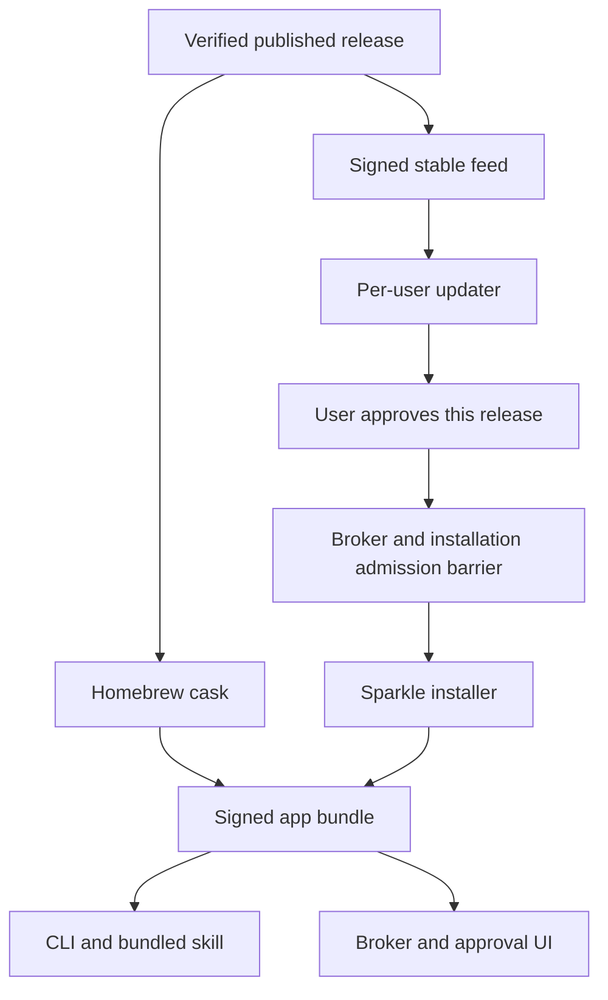
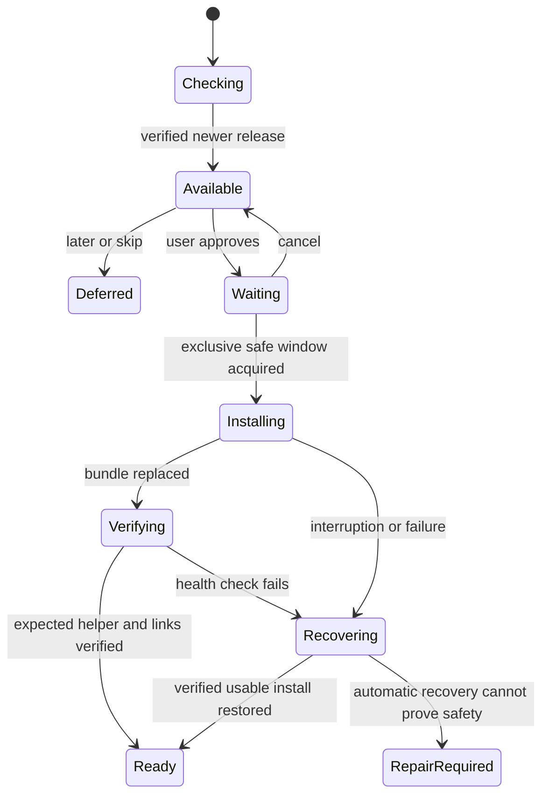

## Goal Capsule

- Objective: users discover new Agent Secret releases automatically and install
  them from the app after approving each update.
- Recommended means: Sparkle 2, the existing signed app bundle, and one update
  path shared by Homebrew and direct installations.
- Status: implementation and PR preparation were authorized after planning.
  The [validation record](../automatic-update-validation.md) tracks test
  results and the remaining release gates.
- Delivery: one implementation PR, followed by signed release-candidate
  validation and a maintainer-controlled public release.
- Stop conditions: do not ship installation until the signed integration drill
  proves safe process coordination, signature rejection, and recovery.

---

## Product Contract

### Summary

Preserve Homebrew, add native update checks and approved installation, and keep
the app, CLI, helper, and bundled skill on one release. Recommend Homebrew as
the primary installation method with the same DMG as a simple secondary path.

### Problem Frame

Users currently need to remember to upgrade through Homebrew, rerun the
installer, or replace the app manually. The existing release process already
produces a signed and notarized DMG, but it has no update feed or resident
updater. Homebrew accounts for most installations according to the maintainer;
preserving that path matters more than enforcing one exclusive installer.

### Requirements

#### User control

- R1. Check for releases automatically, with an accessible setting to disable
  checks and a manual Check for Updates action.
- R2. Require user approval for every installation. Do not offer or enable
  silent automatic installation.
- R3. Install approved updates from the app for Homebrew and direct installs.
- R4. Preserve Homebrew installation, upgrade, reinstall, and uninstall.

#### Safety and operations

- R5. Authenticate updates and update information before using them; preserve
  production signing, notarization, and existing peer-trust checks.
- R6. Defer installation while approval requests, secret resolution, supervised
  commands, or live reusable sessions need the current broker. Do not terminate
  children or save secret-bearing session state to disk for an update.
- R7. An update failure leaves a working installation or a clear, tested
  recovery path. Offline checks never block normal secret operations.
- R8. Publish updater metadata automatically from verified release artifacts
  after the maintainer publishes a release. Drafts do not reach stable users.
- R9. Update requests and logs contain no secrets, references, commands, session
  tokens, or project metadata. Leave optional system profiling disabled.

### User decisions

- Approval for each installation (session-settled: user-directed, chosen over
  optional or default unattended installation). Governs R1 and R2.
- In-app updates for all installation methods (session-settled: user-directed,
  chosen over a Terminal handoff or Homebrew-only upgrade experience).
  Governs R3 and R4.
- Homebrew must remain supported. Homebrew-only installation is acceptable but
  not selected; the user explicitly welcomes cleaner alternatives.

### Installation options

<!-- markdownlint-disable MD013 -->

| Option | User experience | Maintenance judgment |
| --- | --- | --- |
| Homebrew primary, DMG secondary, Sparkle updates | Existing Homebrew flow; native alternative; same update UI | Recommended: one artifact and updater |
| Homebrew only, Sparkle updates | Familiar to current users; requires Homebrew for newcomers | Fewer setup instructions, similar updater work |
| Homebrew owns updates, native app runs brew | In-app approval plus package-manager progress/errors | Avoid: substantial process and prompt handling |
| Signed PKG plus Homebrew | Installer can place additional files | Avoid for now: extra packaging and lifecycle rules |
| Custom updater using TUF | Fully controlled update behavior | Avoid for now: much more installer work |

<!-- markdownlint-enable MD013 -->

These are engineering assessments, not claims of measured implementation cost.
The supporting capabilities and source links are in
[the research notes](../automatic-update-research.md).
Homebrew-only reduces onboarding variants; it does not remove background
checking, native updating, signing, or broker coordination work.
Keeping a basic DMG is inexpensive because Homebrew already downloads it.

### Proposed experience

Open Agent Secret to see installation status, diagnostics, update preferences,
and Check for Updates. A small per-user background component checks about once
a day after the user enables checks; the app explains this during setup.
It appears in macOS background-item controls and needs no new menu-bar icon.

When an update is available, show the version and authenticated release notes
outside secret approval prompts. Offer Install Update, Later, and Skip Version.
Install Update waits for Agent Secret to become idle. Show why it is waiting
without revealing command arguments or secret references, and allow cancellation.
Do not add a force-update button that discards active sessions in this release.

### Boundaries

Scope is the existing Apple Silicon/macOS 14+ product. Linux, Windows, paid
update services, App Store migration, delta patches, beta-channel UI, and
unattended installation are excluded. Full DMGs are sufficient initially.

Recommend simplifying public onboarding to Homebrew plus DMG and retiring the
custom shell bootstrap as a promoted installation method. Keep its existing
release URL working through the bootstrap transition; do not silently replace
an unattended installer with a new interactive operation.
Removal of compatibility assets is a later explicit release decision.

Do not build automatic downgrade, custom cryptography, a root updater daemon,
or a session-migration store. Recovery uses a higher-version corrective release
or an explicit reinstall. Reconsider TUF if stronger repository-freshness
guarantees or cross-platform distribution become requirements.

---

## Planning Contract

### Current implementation

- `approver/Sources/AgentSecretApproverApp/AgentSecretApproverMain.swift` exits
  after setup or approval; it is not a resident menu-bar app.
- `internal/daemon/control/manager.go` starts a detached helper, checks its
  build identity, and can replace it. It is not an existing login service.
- `internal/daemon/server.go` retires a changed executable after active work,
  but `StatusPayload` only reports a PID and `ActiveCount()` excludes idle
  sessions. Neither provides a transaction for installing an update.
- `internal/daemon/broker/broker.go` clears sessions and reusable grants when
  stopped. Session lifetime must remain memory-only.
- `scripts/build/build-app-bundle.sh` packages all product components and the
  skill. `scripts/lib/bundle-metadata.sh` defaults the build version to `1`.
- `.github/workflows/ci.yml` builds draft releases; `docs/release-process.md`
  requires artifact verification, publication, and a Homebrew cask bump.

### Key technical decisions

- KTD1. Use the current reviewed Sparkle 2 release, pinned with package
  resolution. Research found 2.10.1; recheck advisories before implementation.
  Sparkle provides native update UI, archive verification, replacement, and
  relaunch. It fits the current distribution better than building those pieces.
  See [Sparkle releases](https://github.com/sparkle-project/Sparkle/releases).
- KTD2. Add a small nested updater application, registered per user through
  SMAppService when checking is enabled. Keep the existing approval process
  short-lived. Use SPUUpdater with the outer app as hostBundle and the updater
  helper as applicationBundle. This is supported by the API shape but requires
  a signed integration drill for this particular bundle arrangement.
  See [SPUUpdater][spu] and [Apple background services][smappservice].
- KTD3. Replace the complete app bundle. Preserve stable CLI and skill symlink
  targets; never update these components independently or rewrite user-owned
  project instruction files. Existing copies of the skill are not auto-managed.
- KTD4. Use HTTPS, Developer ID-signed/notarized app and DMG, and Ed25519 archive
  signatures. Enable verification before extraction and signed feeds/release
  notes. Set signed-feed failure expiry to zero, so failure does not eventually
  relax that policy. Keep a protected backup of the feed key and document that
  losing it can require manual recovery. See [Sparkle settings][settings].
- KTD5. Disable Sparkle automatic installation explicitly, including its UI
  option, per R2. Approval is specific to the offered release; a newer candidate
  requires approval again. Checking and notification do not acquire secrets.
- KTD6. Put update admission in the broker/control boundary. The updater gets
  narrow, authenticated metadata/control access, not general secret-request
  access. Coordinate all existing work before arming any Sparkle installation.
  A relaunch callback or a PID check is insufficient; see
  [Sparkle delegate contracts][delegate].
- KTD7. Keep the current DMG as the single release payload. Generate signed
  feeds with pinned Sparkle tools, after final signing/notarization/stapling.
  Use versioned GitHub asset URLs and a stable HTTPS feed on the project domain.
  See [publishing updates][publishing].
- KTD8. Preserve Homebrew receipts as Homebrew owns them; do not edit them after
  Sparkle updates. Add `auto_updates true`, and distinguish receipt version
  from actual bundle version in diagnostics. See [Homebrew casks][casks].

### Installation coordination

Checking and downloading must be separate from permission to replace the app.
The final idle test and admission barrier must be atomic: no new approval,
session creation/resolution, or supervised command can slip between them.
Pending approvals and in-progress provider calls count as busy too.

The coordination state may persist non-secret transaction metadata, but never
session values or tokens. New CLI/helper starts must respect installation in
progress across old-helper shutdown, bundle replacement, and new-helper start.
Cancellation or installer failure must release the barrier after verifying
which signed bundle is present; a timeout alone is not proof of safe recovery.

Sparkle's install-on-quit and helper-crash paths must not bypass this barrier.
Do not arm an installer before obtaining it. Keep the implementation of this
coordination small, but treat the invariant as a release requirement.

Homebrew upgrade, reinstall, and uninstall must participate in the same
installation exclusion through cask lifecycle hooks. Prevent simultaneous
Homebrew and Sparkle mutations, including failure and cancellation paths.
The bootstrap upgrade from older casks cannot retroactively add these guards;
document that one-time upgrade as a maintenance operation with sessions closed.
Manual Finder replacement is also an explicit maintenance/recovery operation,
outside the coordinated in-app installation guarantee.

The app in `/Applications` can be shared by multiple logged-in users.
A per-user broker lock alone is insufficient. The first release should defer
installation when another logged-in session could be using that bundle and
safety cannot be established. Do not add a privileged cross-user coordinator.
The signed drill must verify this conservative policy rather than infer it
from a single user's socket status. Admission must also exclude a broker
started by a newly logged-in user during replacement. A one-time snapshot of
logged-in users is not sufficient; if a shared bundle-scoped barrier cannot
establish this invariant, refuse in-app installation on that shared setup.

### Architecture and lifecycle

### Release publication and recovery

1. Assign a valid, increasing CFBundleVersion to each release; keep the readable
   version separate. Reject regressions and reused release build numbers.
2. Build and notarize the complete app and DMG using current trust guards.
3. Generate archive signatures, authenticated notes from CHANGELOG.md, and the
   signed candidate appcast. Disable delta generation initially.
4. Verify draft assets and the old-to-new signed update before publication.
5. When the maintainer publishes, verify the exact public assets, update and
   validate the Homebrew cask, then promote the signed stable feed.
6. Serialize the complete cask-and-feed publication transaction and reject
   stale versions before either mutation, including retries after partial
   success. Store the feed separately
   from ordinary website deploy output so a site deploy cannot roll it back.
7. Fetch the public feed and payload after promotion and verify their signatures
   and version agreement. Failed promotion leaves the prior feed intact.

Use a protected signing environment and pinned workflow actions. Pass signing
keys through a protected keychain or stdin, never command arguments or logs.
Feed hosting must not have access to signing keys. Ensure a publication event
actually triggers promotion; GitHub-token-created events may need an explicit
workflow handoff. The cask update must not require moving the release tag.

Start with an internal signed feed, then a small opt-in pilot. Sparkle supports
phased availability, but manual checks can bypass it, so it is not a safety gate.
Withdrawing an item stops future discovery; it does not recall installed or all
already-downloaded updates. Correct a bad release with a higher build number.
Signed feeds do not provide all of TUF's protection against withheld updates.

### Assumptions and remaining proof

No product decision blocks the technical spike. Homebrew-only versus keeping
DMG onboarding remains a recommendation to confirm before changing public docs;
it does not change the proposed updater architecture.

The nested-helper lifecycle, exact Sparkle installation interception, and
cross-user deferral need real signed validation in U1. No runtime verification
has been performed during this planning session. If the safe installation
boundary cannot be demonstrated, stop and revise the design before release.

---

## Implementation Units

### U1. Prove packaging and signed update lifecycle

**Goal:** validate KTD1, KTD2, KTD4, and KTD7 with two signed builds.
**Requirements:** R3, R5, R7. **Dependencies:** none.
**Files:** `approver/Package.swift`, new `approver/Package.resolved`,
`scripts/build/build-app-bundle.sh`, `scripts/lib/bundle-metadata.sh`,
new `approver/Sources/AgentSecretUpdaterApp/`,
new `scripts/release/smoke-app-update.sh`,
`scripts/release/test-release-version.sh`.

**Approach:** verify framework embedding, runpaths, nested signing, monotonic
versions, SMAppService registration, and replacing/relaunching the nested
updater. Keep production hardened runtime intact. Record sanitized observations
and exact smoke commands in a new `docs/automatic-update-validation.md`.
Treat this as a development spike until U2 and U3 make it safe for users.
Test a small user-driver adapter that withholds Sparkle's Install reply until
admission; a later install-choice notification or relaunch callback cannot be
the first gate. Prefer the standard UI behind that adapter.

**Test scenarios:**

- A signed older build updates the entire bundle and starts the expected helper.
- Corrupt archive, wrong key, modified feed, and modified notes are rejected.
- A read-only/translocated app and a non-writable destination produce useful
  recovery instructions without changing permissions broadly.
- Updater termination, logout, installer interruption, and failed relaunch
  establish which paths can install and when the admission barrier is needed.
- Competing Homebrew mutation and another user's broker start cannot bypass
  the bundle-scoped installation barrier.

**Verification:** real signed/notarized evidence; mocks cannot establish OS
registration, Gatekeeper, or helper relaunch behavior.

### U2. Coordinate installation with broker work

**Goal:** enforce KTD6 across the whole replacement window.
**Requirements:** R5, R6, R7, R9. **Dependencies:** U1.
**Files:** `internal/daemon/protocol/protocol.go`,
`internal/daemon/server.go`, `internal/daemon/control/manager.go`,
`internal/daemon/broker/broker.go`, `internal/daemon/broker/session_store.go`,
`internal/daemon/peertrust/client.go`, new `internal/daemon/update_gate_test.go`,
`internal/daemon/broker/lifecycle_test.go`,
`internal/daemon/control/manager_test.go`.

**Approach:** extend existing identity validation and lifecycle coordination,
using metadata-only status and a bounded installation transaction. Add failing
unit/race tests before implementation. Reuse current stale-helper recovery.

**Test scenarios:**

- Pending approval, provider resolution, running exec, running with-session,
  and idle-but-live session each prevent replacement.
- Work arriving concurrently with installation is either admitted before the
  barrier or refused with retry guidance; it is never partly admitted.
- Unknown or wrong-signed clients cannot claim update-control authority.
- A correctly signed updater cannot invoke secret/session/approval methods;
  an ordinary CLI cannot approve installation. Trust is role-specific.
- Cancellation, helper restart, and failed replacement recover without
  restoring secrets from disk or killing an approved child.
- Another logged-in user's possible use causes conservative deferral, and a
  new login/broker start cannot enter during replacement.

**Verification:** broker/control tests prove synchronization and trust checks;
repeat the signed U1 drill to prove that Sparkle cannot bypass the barrier.

### U3. Add checks, preferences, and approved installation UI

**Goal:** deliver the selected update experience through one coordinator.
**Requirements:** R1, R2, R3, R9. **Dependencies:** U1, U2.
**Files:** `approver/Sources/AgentSecretApproverApp/SetupDialog.swift`,
`approver/Sources/AgentSecretUpdaterApp/`,
new `approver/Sources/AgentSecretUpdater/`,
new `approver/Tests/AgentSecretUpdaterTests/UpdatePolicyTests.swift`,
new `approver/Tests/AgentSecretUpdaterTests/UpdateCoordinatorTests.swift`,
`internal/cli/app.go`, new `internal/cli/app_update.go`,
new `internal/cli/app_update_test.go`, `internal/cli/help.go`.

**Approach:** provide daily checks, manual checking, saved preferences,
non-disruptive notification, and install/later/skip choices. Add a metadata-only
CLI update status/check surface and an action that opens the native updater.
Agents can discover updates and open the UI; no CLI/API option bypasses the
human approval step.
Use the actual CLI/help organization when implementation begins.

**Test scenarios:**

- Disabled checks and OS-disabled background items stay disabled after upgrade.
- New releases prompt once appropriately; Later/Skip behave consistently.
- Every install requires approval; no silent-update setting is exposed.
- Waiting installation can be canceled; a changed release requires new approval.
- Offline service and malformed metadata do not affect secret operations.
- Notifications never take keyboard focus from an approval, and diagnostics
  contain no secret-bearing data.

**Verification:** policy/coordinator tests plus native foreground/accessibility
smokes; network tests use synthetic metadata and test signing keys.

### U4. Automate release metadata publication

**Goal:** publishing a verified release makes it available without hand-editing
updater metadata. **Requirements:** R5, R8. **Dependencies:** U1.
**Files:** `.github/workflows/ci.yml`, new
`.github/workflows/publish-updates.yml`, `scripts/release/build-release.sh`,
new `scripts/release/generate-update-feed.sh`,
new `scripts/release/promote-update-feed.sh`,
new `scripts/release/test-update-feed.sh`, `docs/release-process.md`.

**Approach:** implement KTD7 and the publication sequence above. Reuse existing
tag ancestry, changelog, signing, draft-asset, and published-asset immutability
checks. Add signing backup/rotation and corrective-release runbooks.

**Test scenarios:**

- Drafts, prereleases, failed checks, and unavailable assets never reach stable.
- Feed, DMG, notes, cask, and bundle version identify the same release.
- Concurrent or rerun promotions cannot downgrade either the cask or feed,
  including a retry after the cask succeeded but feed publication failed.
- Signature failure or hosting failure preserves the last known-good feed.
- An ordinary site deployment cannot replace updater metadata.

**Verification:** fixture-based publication tests and a private-feed promotion
drill, followed by verification of exact public bytes during release.

### U5. Preserve installation paths and complete rollout

**Goal:** make upgrades and recovery predictable for existing users.
**Requirements:** R3, R4, R7. **Dependencies:** U2, U3, U4.
**Files:** `Casks/agent-secret.rb`, `install.sh`, `uninstall.sh`,
`scripts/test-install.sh`, `scripts/test-uninstall.sh`,
`scripts/release/test-homebrew-cask.sh`, `README.md`, `site/index.html`,
`.agents/skills/agent-secret/SKILL.md`, `CHANGELOG.md`,
`docs/macos-vm-validation.md`, `docs/automatic-update-validation.md`.

**Approach:** keep Homebrew first in onboarding; recommend the same DMG as the
secondary option. Add cask self-update metadata, updater deregistration on
uninstall, and explicit legacy-install migration. Retain stable CLI/skill links
and user settings. Old releases require one ordinary upgrade to gain Sparkle.
Do not assume Homebrew can adopt a different-version app: `--adopt` requires
matching artifacts. Never use `--zap` as an upgrade step.

**Test scenarios:**

- Homebrew install, Sparkle update, then Homebrew upgrade/reinstall/uninstall
  preserve correct bundle identity, symlinks, and updater registration.
- Homebrew upgrade/reinstall/uninstall racing a Sparkle install waits or
  refuses safely; cancellation cannot release another installer's exclusion.
- Existing DMG and shell-installed versions reach the bootstrap release
  without losing configuration, Keychain entries, or audit history.
- Uninstall removes the updater registration and does not leave a retry loop.
- Development builds and stale PATH entries cannot update or replace a
  production app unexpectedly.
- Clean-account and two-user drills cover installation ownership and deferral.

**Verification:** publishable evidence in the existing macOS VM workflow,
including test-only secret execution that never prints fetched values.

---

## Verification Contract

Follow AGENTS.md: test new behavior first; use opt-in integration tests for OS
and provider interactions. Run `mise run setup` before implementation and
`mise run lint`, `mise run build`, and `mise run test:race` for the completed
change. Extend the existing shell release smokes rather than duplicating them.
Lint new Markdown with `npx --yes markdownlint-cli` and the repository Markdown
check. Tests must use synthetic values or sanitized metadata.

Production acceptance requires two genuinely signed/notarized builds, the
old-to-new update drill, rejection of tampered artifacts, idle-barrier race
coverage, shared-user deferral, Homebrew coexistence, and recovery from an
interrupted installation. A successful framework build alone is insufficient.

## Definition of Done

Users on the bootstrap release discover an offered update automatically,
approve it in the app, and receive a matching app/CLI/helper/skill release.
No install occurs without approval or during protected work. Existing
Homebrew workflows work after a native update. Published metadata is generated,
authenticated, and promoted only after the release and cask are available.
Recovery, key backup, migration, and public instructions are documented.
Remove spike-only code and abandoned integration approaches before shipping.

The maintainer owns release publication. This plan does not authorize creating
production signing keys, deploying a feed, or releasing the implementation.

[spu]: https://sparkle-project.org/documentation/api-reference/Classes/SPUUpdater.html
[smappservice]: https://developer.apple.com/documentation/servicemanagement/smappservice
[settings]: https://sparkle-project.org/documentation/customization/
[delegate]: https://github.com/sparkle-project/Sparkle/blob/2.10.1/Sparkle/SPUUpdaterDelegate.h
[publishing]: https://sparkle-project.org/documentation/publishing/
[casks]: https://docs.brew.sh/Cask-Cookbook#optional-stanzas
